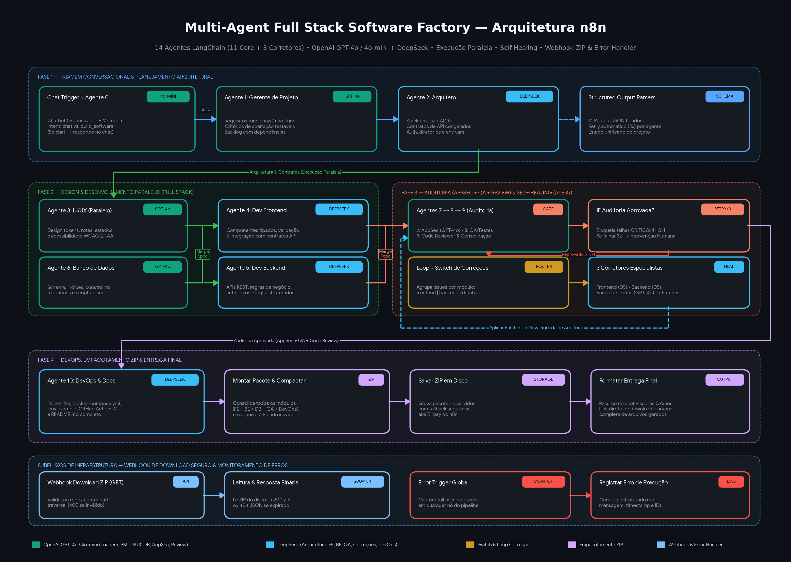
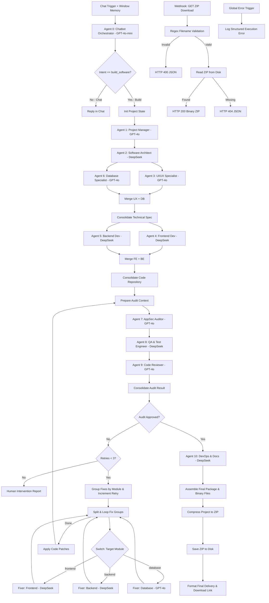
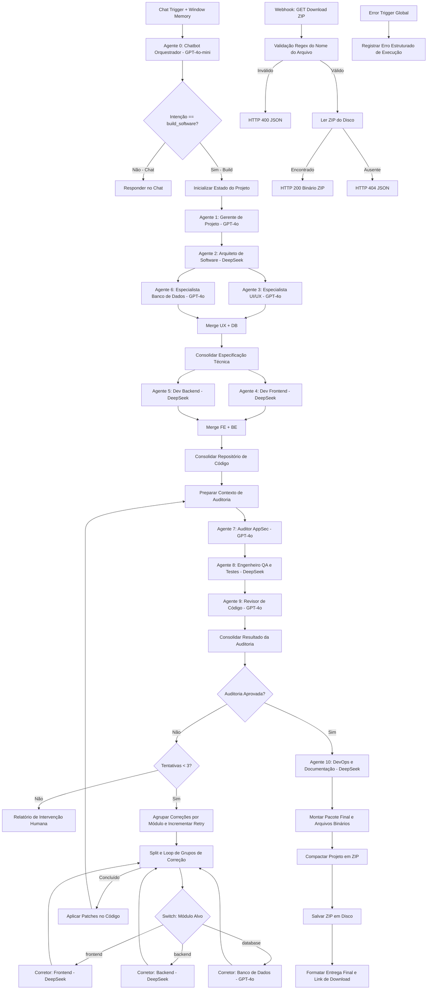

<a id="top"></a>

<div align="center">

# 🤖 Multi-Agent Full Stack Software Factory

### n8n · LangChain AI Agents · OpenAI (`GPT-4o` & `GPT-4o-mini`) · DeepSeek

<p>
  <a href="#english"><kbd>🇺🇸 English Version</kbd></a>&nbsp;&nbsp;
  <a href="#portugues"><kbd>🇧🇷 Versão em Português</kbd></a>
</p>

<br/>


<br/>

<p>
  <kbd>⚡ 14 AI Agents</kbd>&nbsp;
  <kbd>🧩 66 Nodes · 59 Connections</kbd>&nbsp;
  <kbd>🧠 OpenAI GPT-4o / 4o-mini + DeepSeek</kbd>&nbsp;
  <kbd>🛡️ Showcase: Redacted Blueprint</kbd>
</p>

</div>

---

<a id="english"></a>

## 🇺🇸 English Documentation

> **From a single chat prompt to an audited, Dockerized Full Stack repository — orchestrated by 14 specialized AI agents in n8n.**

An end-to-end **conversational multi-agent Full Stack software factory** built in **n8n** using native LangChain AI Agents, conversational window memory, and 14 strict Structured Output Parsers. Through a chat interface, a user describes an application idea; the workflow triages intent, designs architecture, runs **parallel UI/UX + Database** and **parallel Frontend + Backend** engineering stages, executes a **3-stage Security/QA/Code-Review audit pipeline**, dispatches **module-targeted self-healing fixers** (up to 3 retries), packages Docker/CI/CD artifacts, and serves the finished repository as a downloadable `.zip` via a secure webhook endpoint.

<p align="center">
  <a href="#en-highlights">Highlights</a> ·
  <a href="#en-canvas">Workflow Canvas</a> ·
  <a href="#en-architecture">Architecture</a> ·
  <a href="#en-agents">14 AI Agents</a> ·
  <a href="#en-blueprint">Blueprint Protection</a> ·
  <a href="#en-structure">Repository Structure</a> ·
  <a href="#en-license">License</a>
</p>

> [!IMPORTANT]
> **Intellectual Property & Redacted Blueprint Notice:** This repository is published strictly as a **portfolio showcase**. The file `workflow/multi_agent_fullstack_factory_blueprint.json` preserves the real **66-node topology and 59 connection graphs** for architectural inspection, but is **intentionally redacted and non-functional** — all proprietary system prompts, structured JSON schemas, JavaScript orchestration logic, webhook endpoints, and credentials have been removed. Contact me for a live walkthrough or licensing inquiries.

---

<a id="en-highlights"></a>

### ✨ Key Architectural Highlights

<table>
  <tr>
    <td width="50%" valign="top">
      <h4>💬 Conversational Intent Triage</h4>
      <p><strong>Agent 0 + Window Memory</strong> maintains session context to clarify vague requests (<code>chat</code>) before triggering the full engineering pipeline (<code>build_software</code>).</p>
    </td>
    <td width="50%" valign="top">
      <h4>🤖 14 LangChain Agents + Strict Parsers</h4>
      <p><strong>11 core pipeline agents</strong> (<code>Agent 0</code> to <code>Agent 10</code>) plus <strong>3 dedicated self-healing fixers</strong> (<code>Frontend</code>, <code>Backend</code>, <code>Database</code>), each paired with a strict Structured Output Parser and automatic 3x retry resilience.</p>
    </td>
  </tr>
  <tr>
    <td width="50%" valign="top">
      <h4>⚡ Dual-Stage Parallel Execution</h4>
      <ul>
        <li><strong>Design &amp; Data Phase:</strong> <code>UI/UX Specialist</code> (WCAG 2.1 AA) and <code>Database Specialist</code> run concurrently and merge into a unified technical specification.</li>
        <li><strong>Implementation Phase:</strong> <code>Frontend Developer</code> and <code>Backend Developer</code> code concurrently against frozen API contracts before merging into a unified codebase.</li>
      </ul>
    </td>
    <td width="50%" valign="top">
      <h4>🧠 Hybrid Multi-Model Allocation</h4>
      <p>Balances latency, reasoning depth, and API cost across <strong>5 dedicated model nodes</strong>:</p>
      <ul>
        <li><code>GPT-4o-mini</code> — conversational triage.</li>
        <li><code>GPT-4o</code> — PM, UI/UX, DB, AppSec, Code Review &amp; DB fixes.</li>
        <li><code>DeepSeek</code> — Architecture, FE, BE, QA, DevOps &amp; FE/BE fixes.</li>
      </ul>
    </td>
  </tr>
  <tr>
    <td width="50%" valign="top">
      <h4>🛡️ 3-Stage Audit &amp; Targeted Self-Healing</h4>
      <p><code>AppSec Auditor</code> → <code>QA &amp; Test Engineer</code> (separating verified static checks from recommended runtime checks) → <code>Code Reviewer</code>. Blocking <code>CRITICAL</code>/<code>HIGH</code> issues are grouped by module and routed via <code>Switch</code> to the exact responsible fixer (up to <strong>3 cycles</strong>); unresolved builds halt safely and generate a <strong>Human Intervention Report</strong>.</p>
    </td>
    <td width="50%" valign="top">
      <h4>📦 Secure ZIP Webhook &amp; Error Handling</h4>
      <p>Includes a dedicated <code>GET</code> binary download endpoint with strict filename regex validation (anti-path-traversal, returning HTTP <code>200</code>, <code>400</code>, or <code>404</code>), plus a global <code>Error Trigger</code> for structured failure logging.</p>
    </td>
  </tr>
</table>

<div align="center">
  <br/>
  
  <br/><br/>
  <kbd>n8n</kbd>&nbsp;
  <kbd>LangChain AI Agents</kbd>&nbsp;
  <kbd>OpenAI GPT-4o &amp; GPT-4o-mini</kbd>&nbsp;
  <kbd>DeepSeek</kbd>&nbsp;
  <kbd>Structured Output Parsers</kbd>&nbsp;
  <kbd>Webhooks</kbd>
</div>

---

<a id="en-canvas"></a>

### 🖼️ Workflow Canvas Previews (Real n8n Execution Graph)

#### Full Workflow Overview (66 Nodes · 59 Connections)
<p align="center">
  
</p>

<details open>
<summary><strong>🔍 Part 1 — Conversational Intake, Planning, Parallel UI/UX &amp; Database, Secure ZIP Webhook &amp; Error Handler</strong></summary>
<br/>
<p align="center">
  
</p>
</details>

<details>
<summary><strong>🔍 Part 2 — Parallel Frontend/Backend Development, Audit Pipeline &amp; Targeted Self-Healing Loop</strong></summary>
<br/>
<p align="center">
  
</p>
</details>

<details>
<summary><strong>🔍 Part 3 — Quality Gate, Human Escalation, DevOps Packaging &amp; Module-Specific Fixer Agents</strong></summary>
<br/>
<p align="center">
  
</p>
</details>

---

<a id="en-architecture"></a>

### 🏗️ System Architecture

<p align="center">
  
</p>

<details>
<summary><strong>🔀 View Interactive Mermaid Flowchart (Click to expand)</strong></summary>



</details>

---

<a id="en-agents"></a>

### 🧠 The 14 AI Agents & Hybrid Model Allocation

| Agent | Role | LLM Tier | Output / Responsibility |
|---|---|---|---|
| **Agent 0** | Chatbot Orchestrator | `OpenAI GPT-4o-mini` | Conversational memory, intent classification (`chat` vs. `build_software`), brief consolidation. |
| **Agent 1** | Project Manager | `OpenAI GPT-4o` | Functional/non-functional requirements, constraints, acceptance criteria, dependency backlog. |
| **Agent 2** | Software Architect | `DeepSeek` | Lean stack selection, ADRs, directory tree, frozen API contracts, auth strategy, env vars. |
| **Agent 3** | UI/UX Specialist | `OpenAI GPT-4o` | Design tokens, routes, component library, UI states, WCAG 2.1 AA accessibility rules. |
| **Agent 4** | Frontend Developer | `DeepSeek` | Complete typed frontend codebase, forms, API client, and dependency manifests. |
| **Agent 5** | Backend Developer | `DeepSeek` | Complete REST API, business logic, auth/authorization, input validation, structured logs. |
| **Agent 6** | Database Specialist | `OpenAI GPT-4o` | Database schema, relations, composite indexes, constraints, migrations, and seed scripts. |
| **Agent 7** | Security Auditor (AppSec) | `OpenAI GPT-4o` | OWASP static review (SQLi, XSS, CSRF, IDOR, CORS, secrets) and severity scoring. |
| **Agent 8** | QA & Test Engineer | `DeepSeek` | Contract verification + automated unit/integration/E2E test files (static vs. runtime split). |
| **Agent 9** | Code Reviewer & Auditor | `OpenAI GPT-4o` | Architecture/code quality review consolidating AppSec + QA into targeted module `fix_tasks`. |
| **Fixers (×3)** | Frontend / Backend / DB Fixers | `DeepSeek` (FE/BE) / `GPT-4o` (DB) | Surgical self-healing patches routed by module during the automated retry loop (up to 3x). |
| **Agent 10** | DevOps & Documentation | `DeepSeek` | Secure `Dockerfile`, `docker-compose.yml`, `.env.example`, GitHub Actions CI, and `README.md`. |

---

<a id="en-blueprint"></a>

### 🔒 What Is Protected in the Blueprint (`workflow/`)

> [!NOTE]
> Designed to demonstrate real engineering complexity while safeguarding proprietary intellectual property.

<table>
  <tr>
    <td width="50%" valign="top">
      <h4>✅ Preserved for Inspection</h4>
      <ul>
        <li>All <strong>66 nodes</strong> and <strong>59 real connections</strong> preserved in the n8n graph.</li>
        <li>Full parallel branching, audit loop, webhook download subflow, and global error-handling topology.</li>
        <li>Illustrative output contracts in <code>examples/</code>.</li>
      </ul>
    </td>
    <td width="50%" valign="top">
      <h4>🔐 Redacted &amp; Non-Functional</h4>
      <ul>
        <li>All <strong>14 agent prompts</strong>, <strong>14 output schemas</strong>, <strong>5 model nodes</strong>, and credentials replaced by non-functional placeholders.</li>
        <li>All <strong>13 JavaScript code nodes</strong> replaced by commented stubs that throw an error if executed.</li>
        <li><code>IF</code>/<code>Switch</code> routing expressions, disk paths, and webhook endpoints fully redacted.</li>
      </ul>
    </td>
  </tr>
</table>

---

<a id="en-structure"></a>

### 📁 Repository Structure

```text
n8n-multi-agent-fullstack-factory/
├── README.md
├── LICENSE                                                  # All Rights Reserved (Portfolio Showcase)
├── .gitignore
├── workflow/
│   └── multi_agent_fullstack_factory_blueprint.json         # Redacted, non-functional 66-node blueprint
├── assets/
│   ├── workflow_overview.png                                # Full n8n canvas overview screenshot
│   ├── workflow_part1_chat_planning_design.png              # Canvas Part 1 (Chat, Planning, Design, Webhook)
│   ├── workflow_part2_dev_audit_loop.png                    # Canvas Part 2 (FE/BE Dev, Audit, Fixer Loop)
│   ├── workflow_part3_audit_devops_zip.png                  # Canvas Part 3 (Gates, DevOps, ZIP, Fixers)
│   └── architecture_diagram.png                             # High-resolution system architecture diagram
└── examples/
    ├── sample_audit_report.json                             # Illustrative AppSec/QA/Review audit output
    └── sample_delivery_summary.md                           # Illustrative final chat delivery summary
```

---

<a id="en-license"></a>

### 📄 License

**All Rights Reserved** — see [`LICENSE`](LICENSE) for intellectual property terms.

<div align="center">

[⬆️ Back to top](#top) · [🇧🇷 Ir para a versão em Português](#portugues)

</div>

---
---

<a id="portugues"></a>

## 🇧🇷 Documentação em Português

> **De uma mensagem no chat a um repositório Full Stack auditado e containerizado com Docker — orquestrado por 14 agentes de IA no n8n.**

**Fábrica de software Full Stack conversacional e multiagente** construída no **n8n** com agentes nativos LangChain, memória conversacional em janela e 14 Structured Output Parsers. Pelo chat, o usuário descreve o sistema desejado; o fluxo faz triagem de intenção, projeta a arquitetura, executa em **paralelo UI/UX + Banco de Dados** e **Frontend + Backend**, passa por uma **esteira de auditoria em 3 etapas (Segurança + QA + Revisão de Código)**, aciona **corretores especialistas por módulo** em ciclo de autocorreção (até 3 tentativas), gera artefatos de DevOps/CI/CD e disponibiliza o projeto completo em `.zip` via webhook seguro de download.

<p align="center">
  <a href="#pt-diferenciais">Diferenciais</a> ·
  <a href="#pt-canvas">Workflow no n8n</a> ·
  <a href="#pt-arquitetura">Arquitetura</a> ·
  <a href="#pt-agentes">14 Agentes</a> ·
  <a href="#pt-blueprint">Proteção do Blueprint</a> ·
  <a href="#pt-estrutura">Estrutura</a> ·
  <a href="#pt-licenca">Licença</a>
</p>

> [!IMPORTANT]
> **Aviso de Propriedade Intelectual (Blueprint Não Funcional):** Este repositório é uma **vitrine de portfólio**. O arquivo `workflow/multi_agent_fullstack_factory_blueprint.json` preserva a topologia real dos **66 nós e 59 grafos de conexão** para inspeção arquitetural, mas está **propositalmente ocultado (redacted) e não executável** — todos os prompts proprietários, schemas JSON de saída, códigos JavaScript de orquestração, caminhos de webhook e credenciais foram removidos. Entre em contato para demonstração ao vivo ou licenciamento.

---

<a id="pt-diferenciais"></a>

### ✨ Diferenciais de Engenharia

<table>
  <tr>
    <td width="50%" valign="top">
      <h4>💬 Triagem Conversacional com Memória</h4>
      <p>O <strong>Agente 0 + Window Memory</strong> mantém o histórico da sessão para tirar dúvidas ou refinar pedidos vagos (<code>chat</code>) antes de disparar a fábrica completa (<code>build_software</code>).</p>
    </td>
    <td width="50%" valign="top">
      <h4>🤖 14 Agentes LangChain + Output Parsers Tipados</h4>
      <p><strong>11 agentes no pipeline principal</strong> (<code>Agente 0</code> a <code>Agente 10</code>) + <strong>3 agentes corretores dedicados</strong> (<code>Frontend</code>, <code>Backend</code>, <code>Banco de Dados</code>), todos com saída JSON estruturada e retry automático (3x).</p>
    </td>
  </tr>
  <tr>
    <td width="50%" valign="top">
      <h4>⚡ Execução Paralela em Duas Etapas</h4>
      <ul>
        <li><strong>Design &amp; Dados:</strong> <code>UI/UX</code> (WCAG 2.1 AA) e <code>Banco de Dados</code> executam simultaneamente e convergem na especificação técnica consolidada.</li>
        <li><strong>Desenvolvimento:</strong> <code>Frontend</code> e <code>Backend</code> são codificados em paralelo sob contratos congelados de API antes da consolidação do repositório.</li>
      </ul>
    </td>
    <td width="50%" valign="top">
      <h4>🧠 Roteamento Híbrido Multi-Modelo</h4>
      <p>Equilibra latência, profundidade de raciocínio e custo em <strong>5 nós de modelo dedicados</strong>:</p>
      <ul>
        <li><code>GPT-4o-mini</code> — triagem no chat.</li>
        <li><code>GPT-4o</code> — PM, UI/UX, DB, AppSec, Revisão e correção DB.</li>
        <li><code>DeepSeek</code> — Arquitetura, FE, BE, QA, DevOps e correções FE/BE.</li>
      </ul>
    </td>
  </tr>
  <tr>
    <td width="50%" valign="top">
      <h4>🛡️ Auditoria em 3 Etapas + Autocorreção Direcionada</h4>
      <p><code>Auditor AppSec</code> → <code>Engenheiro de QA e Testes</code> (diferenciando verificações estáticas de comandos de runtime) → <code>Revisor de Código</code>. Falhas <code>CRITICAL</code>/<code>HIGH</code> são agrupadas por módulo e encaminhadas via nó <code>Switch</code> ao corretor responsável em até <strong>3 ciclos</strong>; persistindo falhas, o fluxo bloqueia a entrega automática e emite um <strong>Relatório de Intervenção Humana</strong>.</p>
    </td>
    <td width="50%" valign="top">
      <h4>📦 Webhook Seguro de Download &amp; Error Handling</h4>
      <p>Subfluxo <code>GET</code> com validação estrita por regex contra <em>path traversal</em> (retornando HTTP <code>200</code>, <code>400</code> ou <code>404</code>), somado a um <code>Error Trigger</code> global para log estruturado de falhas.</p>
    </td>
  </tr>
</table>

<div align="center">
  <br/>
  
  <br/><br/>
  <kbd>n8n</kbd>&nbsp;
  <kbd>LangChain AI Agents</kbd>&nbsp;
  <kbd>OpenAI GPT-4o &amp; GPT-4o-mini</kbd>&nbsp;
  <kbd>DeepSeek</kbd>&nbsp;
  <kbd>Structured Output Parsers</kbd>&nbsp;
  <kbd>Webhooks</kbd>
</div>

---

<a id="pt-canvas"></a>

### 🖼️ Visualização do Workflow no n8n (Capturas Reais)

#### Visão Geral Completa (66 Nós · 59 Conexões)
<p align="center">
  
</p>

<details open>
<summary><strong>🔍 Parte 1 — Chat Orquestrador, Planejamento, UI/UX + Banco em Paralelo, Webhook ZIP e Error Trigger</strong></summary>
<br/>
<p align="center">
  
</p>
</details>

<details>
<summary><strong>🔍 Parte 2 — Desenvolvimento Frontend/Backend em Paralelo, Esteira de Auditoria e Loop de Correções</strong></summary>
<br/>
<p align="center">
  
</p>
</details>

<details>
<summary><strong>🔍 Parte 3 — Portão de Qualidade, Escalação Humana, DevOps + ZIP e os 3 Corretores Especialistas</strong></summary>
<br/>
<p align="center">
  
</p>
</details>

---

<a id="pt-arquitetura"></a>

### 🏗️ Arquitetura do Sistema

<p align="center">
  
</p>

<details>
<summary><strong>🔀 Ver Fluxograma Mermaid Interativo (Clique para expandir)</strong></summary>



</details>

---

<a id="pt-agentes"></a>

### 🧠 Os 14 Agentes e Modelos Utilizados

| Agente | Papel | Modelo | Responsabilidade Principal |
|---|---|---|---|
| **Agente 0** | Chatbot Orquestrador | `OpenAI GPT-4o-mini` | Memória conversacional, triagem de intenção (`chat` vs. `build_software`) e consolidação de briefing. |
| **Agente 1** | Gerente de Projeto | `OpenAI GPT-4o` | Requisitos funcionais/não-funcionais, restrições, critérios de aceitação e backlog com dependências. |
| **Agente 2** | Arquiteto de Software | `DeepSeek` | Stack enxuta, ADRs, estrutura de diretórios, contratos de API congelados, autenticação e env vars. |
| **Agente 3** | Especialista UI/UX | `OpenAI GPT-4o` | Tokens de design, rotas, componentes reutilizáveis, estados de interface e acessibilidade WCAG 2.1 AA. |
| **Agente 4** | Desenvolvedor Frontend | `DeepSeek` | Código frontend completo, tipado, validado e integrado aos contratos de API. |
| **Agente 5** | Desenvolvedor Backend | `DeepSeek` | API REST completa, regras de negócio, autenticação/autorização, validação e logs estruturados. |
| **Agente 6** | Especialista Banco de Dados | `OpenAI GPT-4o` | Schema, relacionamentos, índices compostos, constraints, migrations e script de seed. |
| **Agente 7** | Auditor de Segurança (AppSec) | `OpenAI GPT-4o` | Auditoria OWASP (SQLi, XSS, CSRF, IDOR, CORS, segredos) com score e classificação de severidade. |
| **Agente 8** | Engenheiro de QA e Testes | `DeepSeek` | Verificação de contratos + geração de suítes de testes unitários, integração e E2E. |
| **Agente 9** | Revisor e Auditor de Código | `OpenAI GPT-4o` | Revisão arquitetural e consolidação de AppSec + QA em `fix_tasks` cirúrgicas por módulo. |
| **Corretores (×3)** | Frontend / Backend / Banco | `DeepSeek` (FE/BE) / `GPT-4o` (DB) | Patches direcionados por módulo no loop automático de autocorreção (até 3 tentativas). |
| **Agente 10** | DevOps e Documentação | `DeepSeek` | `Dockerfile`, `docker-compose.yml`, `.env.example`, pipeline GitHub Actions CI e `README.md`. |

---

<a id="pt-blueprint"></a>

### 🔒 O que está protegido no Blueprint (`workflow/`)

> [!NOTE]
> Estruturado para demonstrar a complexidade real de engenharia sem expor propriedade intelectual pronta para cópia.

<table>
  <tr>
    <td width="50%" valign="top">
      <h4>✅ Preservado para Inspeção</h4>
      <ul>
        <li>Todos os <strong>66 nós</strong> e <strong>59 conexões reais</strong> preservados no grafo do n8n.</li>
        <li>Topologia completa de ramificação paralela, loop de auditoria, subfluxo de webhook e tratamento global de erros.</li>
        <li>Exemplos ilustrativos de saída na pasta <code>examples/</code>.</li>
      </ul>
    </td>
    <td width="50%" valign="top">
      <h4>🔐 Ocultado e Não Executável</h4>
      <ul>
        <li>Todos os <strong>14 prompts de agentes</strong>, <strong>14 schemas de saída</strong>, <strong>5 nós de modelo</strong> e credenciais substituídos por placeholders não funcionais.</li>
        <li>Todos os <strong>13 nós de código JavaScript</strong> substituídos por stubs comentados que lançam erro caso executados.</li>
        <li>Expressões de roteamento (<code>IF</code>/<code>Switch</code>), caminhos de disco e endpoints de webhook totalmente ocultados.</li>
      </ul>
    </td>
  </tr>
</table>

---

<a id="pt-estrutura"></a>

### 📁 Estrutura do Repositório

```text
n8n-multi-agent-fullstack-factory/
├── README.md
├── LICENSE                                                  # Todos os direitos reservados (Vitrine de Portfólio)
├── .gitignore
├── workflow/
│   └── multi_agent_fullstack_factory_blueprint.json         # Blueprint protegido e não executável (66 nós)
├── assets/
│   ├── workflow_overview.png                                # Captura geral do canvas no n8n
│   ├── workflow_part1_chat_planning_design.png              # Canvas Parte 1 (Chat, Planejamento, Design, Webhook)
│   ├── workflow_part2_dev_audit_loop.png                    # Canvas Parte 2 (Dev FE/BE, Auditoria, Loop de Correção)
│   ├── workflow_part3_audit_devops_zip.png                  # Canvas Parte 3 (Portões, DevOps, ZIP, Corretores)
│   └── architecture_diagram.png                             # Diagrama de arquitetura em alta resolução
└── examples/
    ├── sample_audit_report.json                             # Exemplo ilustrativo de saída AppSec/QA/Code Review
    └── sample_delivery_summary.md                           # Exemplo ilustrativo do resumo final no chat
```

---

<a id="pt-licenca"></a>

### 📄 Licença

**All Rights Reserved (Todos os Direitos Reservados)** — consulte [`LICENSE`](LICENSE) para os termos de propriedade intelectual.

<div align="center">

[⬆️ Voltar ao topo](#top) · [🇺🇸 Switch to English](#english)

</div>