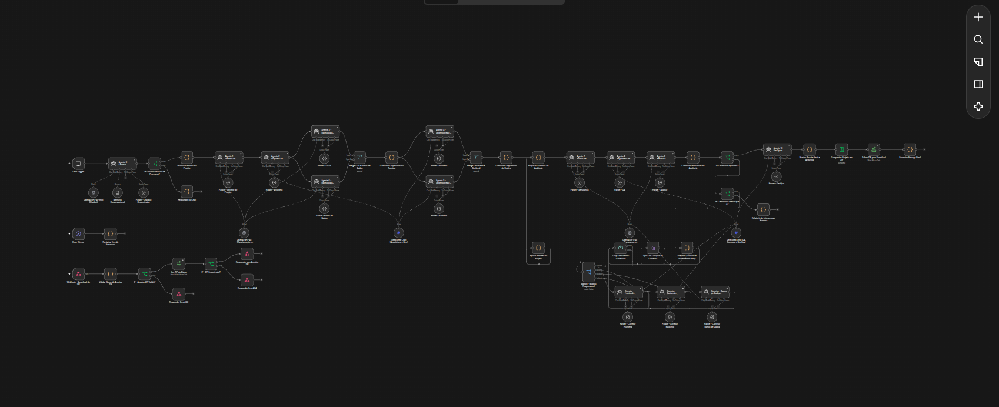
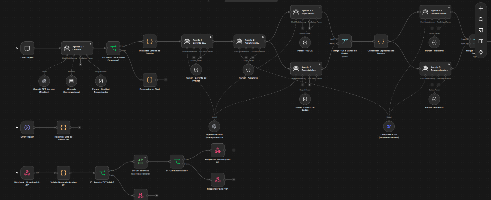
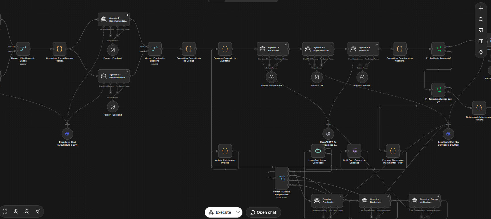
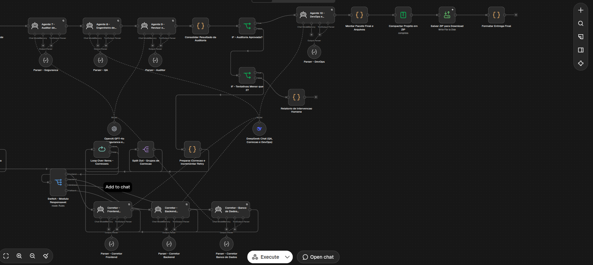
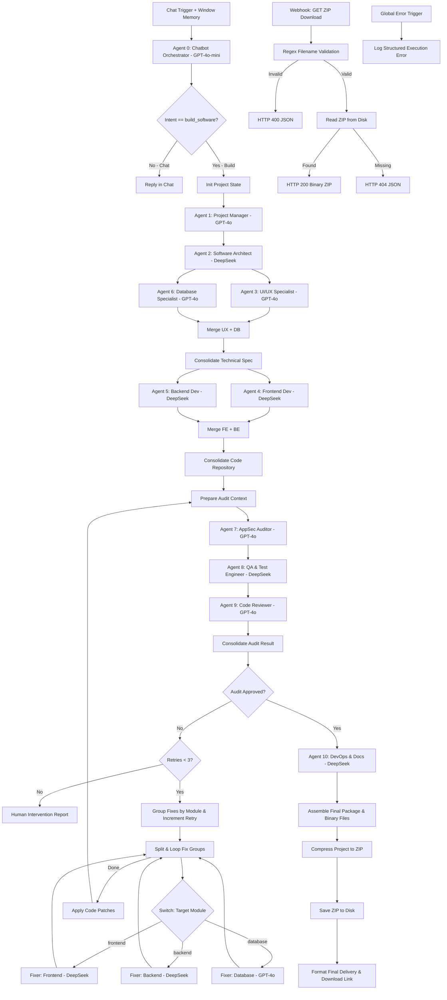

<div align="center">

# Multi-Agent Full Stack Software Factory (n8n + OpenAI + DeepSeek)


**Language / Idioma:** [English](#english) | [Português (Brasil)](#portugues)

</div>

---

<a id="english"></a>

## English

### Overview

An end-to-end **conversational multi-agent Full Stack software factory** built in **n8n** using native LangChain AI Agents, conversational memory, and 14 strict Structured Output Parsers. Through a chat interface, a user describes an application idea; the workflow triages intent, designs architecture, runs **parallel UI/UX + Database** and **parallel Frontend + Backend** engineering stages, executes a **3-stage Security/QA/Code-Review audit pipeline**, dispatches **module-targeted self-healing fixers** (up to 3 retries), packages Docker/CI/CD artifacts, and serves the finished repository as a downloadable `.zip` via a secure webhook endpoint.

> **Intellectual Property & Blueprint Notice:** This repository is published strictly as a **portfolio showcase**. The file `workflow/multi_agent_fullstack_factory_blueprint.json` preserves the real **66-node topology and 59 connection graphs** for architectural inspection, but is **intentionally redacted and non-functional** — all proprietary system prompts, structured JSON schemas, JavaScript orchestration logic, webhook endpoints, and credentials have been removed. Contact me for a live walkthrough or licensing inquiries.

### Workflow Canvas Previews (Real n8n Execution Graph)

#### Full Workflow Overview (66 Nodes)
<p align="center">
  
</p>

#### Part 1 — Conversational Intake, Planning, Parallel UI/UX & Database, Webhook Download & Error Handler
<p align="center">
  
</p>

#### Part 2 — Parallel Frontend/Backend Development, Audit Pipeline & Targeted Self-Healing Loop
<p align="center">
  
</p>

#### Part 3 — Quality Gate, Human Escalation, DevOps Packaging & Module-Specific Fixer Agents
<p align="center">
  
</p>

### Key Architectural Highlights

- **Conversational Intent Triage (`Agente 0` + Window Memory):** keeps conversational history to clarify vague requests (`chat`) before triggering the full engineering pipeline (`build_software`).
- **14 Specialized LangChain AI Agents with Structured Output Parsers:** 11 core pipeline agents (`Agente 0` to `Agente 10`) plus **3 dedicated self-healing fixer agents** (`Frontend`, `Backend`, `Database`), each paired with a strict schema parser and automatic 3x retry resilience.
- **Dual-Stage Parallel Execution:**
  - *Design & Data Phase:* `UI/UX Specialist` (WCAG 2.1 AA) and `Database Specialist` run concurrently and merge into a unified technical specification.
  - *Implementation Phase:* `Frontend Developer` and `Backend Developer` run concurrently against frozen API contracts before merging into a unified codebase.
- **Hybrid Multi-Model Allocation (OpenAI + DeepSeek):** balances latency, reasoning depth, and cost across 5 dedicated model nodes (`GPT-4o-mini` for chat triage, `GPT-4o` for PM/UI-UX/DB/AppSec/Code Review/DB fixes, and `DeepSeek` for Architecture/Frontend/Backend/QA/DevOps/FE-BE fixes).
- **3-Stage Audit Gate & Targeted Self-Healing Loop:** `AppSec Auditor` → `QA & Test Engineer` (separating verified static checks from recommended runtime checks) → `Code Reviewer`. Blocking `CRITICAL`/`HIGH` issues are grouped by module and routed via a `Switch` node to the exact responsible fixer for up to **3 cycles**; unresolved builds halt safely and generate a **Human Intervention Report** instead of releasing unapproved code.
- **Secure Binary Download Webhook & Global Error Handling:** includes a dedicated `GET` download endpoint with strict filename regex validation (anti-path-traversal, returning HTTP `200`, `400`, or `404`), plus a global `Error Trigger` for structured failure logging.

### System Architecture

<p align="center">
  
</p>

<details>
<summary><strong>View Mermaid Flowchart (Click to expand)</strong></summary>



</details>

### The 14 AI Agents & Model Allocation

| Agent | Role | LLM Tier | Output / Responsibility |
|---|---|---|---|
| **Agent 0** | Chatbot Orchestrator | `OpenAI GPT-4o-mini` | Conversational memory, intent classification (`chat` vs. `build_software`), brief consolidation. |
| **Agent 1** | Project Manager | `OpenAI GPT-4o` | Functional/non-functional requirements, constraints, acceptance criteria, dependency backlog. |
| **Agent 2** | Software Architect | `DeepSeek` | Lean stack selection, ADRs, directory tree, frozen API contracts, auth strategy, env vars. |
| **Agent 3** | UI/UX Specialist | `OpenAI GPT-4o` | Design tokens, routes, component library, UI states, WCAG 2.1 AA accessibility rules. |
| **Agent 4** | Frontend Developer | `DeepSeek` | Complete typed frontend codebase, forms, API client, and dependency manifests. |
| **Agent 5** | Backend Developer | `DeepSeek` | Complete REST API, business logic, auth/authorization, input validation, structured logs. |
| **Agent 6** | Database Specialist | `OpenAI GPT-4o` | Database schema, relations, composite indexes, constraints, migrations, and seed scripts. |
| **Agent 7** | Security Auditor (AppSec) | `OpenAI GPT-4o` | OWASP static review (SQLi, XSS, CSRF, IDOR, CORS, secrets) and severity scoring. |
| **Agent 8** | QA & Test Engineer | `DeepSeek` | Contract verification + automated unit/integration/E2E test files (static vs. runtime split). |
| **Agent 9** | Code Reviewer & Auditor | `OpenAI GPT-4o` | Architecture/code quality review consolidating AppSec + QA into targeted module `fix_tasks`. |
| **Fixers (×3)** | Frontend / Backend / DB Fixers | `DeepSeek` (FE/BE) / `GPT-4o` (DB) | Surgical self-healing patches routed by module during the automated retry loop (up to 3x). |
| **Agent 10** | DevOps & Documentation | `DeepSeek` | Secure `Dockerfile`, `docker-compose.yml`, `.env.example`, GitHub Actions CI, and `README.md`. |

### Repository Structure

```text
n8n-multi-agent-fullstack-factory/
├── README.md
├── LICENSE                                                  # All Rights Reserved (Portfolio Showcase)
├── .gitignore
├── workflow/
│   └── multi_agent_fullstack_factory_blueprint.json         # Redacted, non-functional 66-node blueprint
├── assets/
│   ├── workflow_overview.png                                # Full n8n canvas overview screenshot
│   ├── workflow_part1_chat_planning_design.png              # Canvas Part 1 (Chat, Planning, Design, Webhook)
│   ├── workflow_part2_dev_audit_loop.png                    # Canvas Part 2 (FE/BE Dev, Audit, Fixer Loop)
│   ├── workflow_part3_audit_devops_zip.png                  # Canvas Part 3 (Gates, DevOps, ZIP, Fixers)
│   └── architecture_diagram.png                             # High-resolution system architecture diagram
└── examples/
    ├── sample_audit_report.json                             # Illustrative AppSec/QA/Review audit output
    └── sample_delivery_summary.md                           # Illustrative final chat delivery summary
```

---

<a id="portugues"></a>

## Português (Brasil)

### Visão Geral

**Fábrica de software Full Stack conversacional e multiagente** construída no **n8n** com agentes nativos LangChain, memória conversacional e 14 Structured Output Parsers. Pelo chat, o usuário descreve o sistema desejado; o fluxo faz triagem de intenção, projeta a arquitetura, executa em **paralelo UI/UX + Banco de Dados** e **Frontend + Backend**, passa por uma **esteira de auditoria em 3 etapas (Segurança + QA + Revisão de Código)**, aciona **corretores especialistas por módulo** em ciclo de autocorreção (até 3 tentativas), gera artefatos de DevOps/CI/CD e disponibiliza o projeto completo em `.zip` via webhook seguro de download.

> **Aviso de Propriedade Intelectual (Blueprint Não Funcional):** Este repositório é uma **vitrine de portfólio**. O arquivo `workflow/multi_agent_fullstack_factory_blueprint.json` preserva a topologia real dos **66 nós e 59 grafos de conexão** para inspeção arquitetural, mas está **propositalmente ocultado (redacted) e não executável** — todos os prompts proprietários, schemas JSON de saída, códigos JavaScript de orquestração, caminhos de webhook e credenciais foram removidos. Entre em contato para demonstração ao vivo ou licenciamento.

### Visualização do Workflow no n8n (Capturas Reais)

#### Visão Geral Completa (66 Nós)
<p align="center">
  
</p>

#### Parte 1 — Chat Orquestrador, Planejamento, UI/UX + Banco em Paralelo, Webhook ZIP e Error Trigger
<p align="center">
  
</p>

#### Parte 2 — Desenvolvimento Frontend/Backend em Paralelo, Esteira de Auditoria e Loop de Correções
<p align="center">
  
</p>

#### Parte 3 — Portão de Qualidade, Escalação Humana, DevOps + ZIP e os 3 Corretores Especialistas
<p align="center">
  
</p>

### Diferenciais de Engenharia

- **Triagem Conversacional com Memória (`Agente 0`):** mantém histórico da sessão para tirar dúvidas ou refinar pedidos vagos (`chat`) antes de disparar a fábrica (`build_software`).
- **14 Agentes LangChain com Output Parsers Tipados:** 11 agentes no pipeline principal (`Agente 0` a `Agente 10`) + **3 agentes corretores dedicados** (`Frontend`, `Backend`, `Banco de Dados`), todos com saída JSON estruturada e retry automático (3x).
- **Execução Paralela em Duas Etapas:**
  - *Design & Dados:* `UI/UX` (WCAG 2.1 AA) e `Banco de Dados` executam simultaneamente e convergem na especificação técnica consolidada.
  - *Desenvolvimento:* `Frontend` e `Backend` são codificados em paralelo sob contratos congelados de API antes da consolidação do repositório.
- **Roteamento Híbrido Multi-Modelo (OpenAI + DeepSeek):** equilibra latência, raciocínio e custo em 5 nós de modelo dedicados (`GPT-4o-mini` para triagem no chat, `GPT-4o` para PM/UI-UX/DB/AppSec/Revisão/Correção DB e `DeepSeek` para Arquitetura/Frontend/Backend/QA/DevOps/Correções FE-BE).
- **Auditoria em 3 Etapas + Autocorreção Direcionada:** `Auditor de Segurança (AppSec)` → `Engenheiro de QA e Testes` (diferenciando verificações estáticas de comandos de runtime recomendados) → `Revisor de Código`. Falhas `CRITICAL`/`HIGH` são agrupadas por módulo e encaminhadas via nó `Switch` ao corretor responsável em até **3 ciclos**; persistindo falhas, o fluxo bloqueia a entrega automática e emite um **Relatório de Intervenção Humana**.
- **Webhook Seguro de Download e Tratamento Global de Erros:** subfluxo `GET` com validação estrita por regex contra *path traversal* (retornando HTTP `200`, `400` ou `404`), somado a um `Error Trigger` global para log estruturado de falhas.

### Arquitetura do Sistema

<p align="center">
  
</p>

### Os 14 Agentes e Modelos Utilizados

| Agente | Papel | Modelo | Responsabilidade Principal |
|---|---|---|---|
| **Agente 0** | Chatbot Orquestrador | `OpenAI GPT-4o-mini` | Memória conversacional, triagem de intenção (`chat` vs. `build_software`) e consolidação de briefing. |
| **Agente 1** | Gerente de Projeto | `OpenAI GPT-4o` | Requisitos funcionais/não-funcionais, restrições, critérios de aceitação e backlog com dependências. |
| **Agente 2** | Arquiteto de Software | `DeepSeek` | Stack enxuta, ADRs, estrutura de diretórios, contratos de API congelados, autenticação e env vars. |
| **Agente 3** | Especialista UI/UX | `OpenAI GPT-4o` | Tokens de design, rotas, componentes reutilizáveis, estados de interface e acessibilidade WCAG 2.1 AA. |
| **Agente 4** | Desenvolvedor Frontend | `DeepSeek` | Código frontend completo, tipado, validado e integrado aos contratos de API. |
| **Agente 5** | Desenvolvedor Backend | `DeepSeek` | API REST completa, regras de negócio, autenticação/autorização, validação e logs estruturados. |
| **Agente 6** | Especialista Banco de Dados | `OpenAI GPT-4o` | Schema, relacionamentos, índices compostos, constraints, migrations e script de seed. |
| **Agente 7** | Auditor de Segurança (AppSec) | `OpenAI GPT-4o` | Auditoria OWASP (SQLi, XSS, CSRF, IDOR, CORS, segredos) com score e classificação de severidade. |
| **Agente 8** | Engenheiro de QA e Testes | `DeepSeek` | Verificação de contratos + geração de suítes de testes unitários, integração e E2E. |
| **Agente 9** | Revisor e Auditor de Código | `OpenAI GPT-4o` | Revisão arquitetural e consolidação de AppSec + QA em `fix_tasks` cirúrgicas por módulo. |
| **Corretores (×3)** | Frontend / Backend / Banco | `DeepSeek` (FE/BE) / `GPT-4o` (DB) | Patches direcionados por módulo no loop automático de autocorreção (até 3 tentativas). |
| **Agente 10** | DevOps e Documentação | `DeepSeek` | `Dockerfile`, `docker-compose.yml`, `.env.example`, pipeline GitHub Actions CI e `README.md`. |

### O que está protegido no Blueprint (`workflow/`)

Para apresentar a complexidade do projeto sem expor propriedade intelectual copiável:
- Todos os **66 nós e 59 conexões reais** estão preservados para visualização estrutural.
- Todos os **14 prompts de agentes, 14 schemas de saída, 5 nós de modelo e credenciais** foram substituídos por placeholders não funcionais.
- Todos os **13 nós de código JavaScript** foram substituídos por stubs comentados que lançam erro caso executados.
- Expressões de roteamento (`IF`/`Switch`), caminhos de disco e endpoints de webhook foram totalmente ocultados.

---

## License / Licença

All Rights Reserved — see [`LICENSE`](LICENSE) for intellectual property terms.
